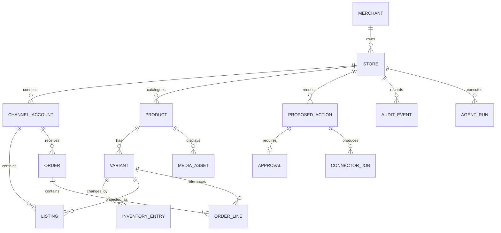

# Canonical domain model

## Purpose

The canonical model separates what the merchant sells from how each marketplace represents it. Marketplace/Shopify payloads must be mapped at the connector boundary and must not leak into core product or inventory entities.

## Primary entities

| Entity | Purpose |
|---|---|
| `Merchant` | Account and owner identity for the prototype |
| `Store` | Shop profile, location, language, and operating settings |
| `ChannelAccount` | Shopify or explicitly labelled development-channel connection state |
| `Product` | Merchant-owned product identity and shared description |
| `Variant` | Sellable SKU with attributes such as colour, size, and unit |
| `MediaAsset` | Uploaded or generated image and provenance |
| `Price` | Current canonical price and currency for a variant |
| `InventoryEntry` | Immutable stock movement or reservation |
| `Listing` | Channel-specific projection of a product/variant |
| `Order` | Normalized order received from a channel |
| `OrderLine` | Variant, quantity, and prices within an order |
| `BuyerQuestion` | Normalized customer question and answer status |
| `ProposedAction` | Typed system or agent-requested mutation |
| `Approval` | Merchant/policy decision and decision context |
| `ConnectorJob` | Durable external command and retry state |
| `AuditEvent` | Immutable record of a meaningful state transition |
| `AgentRun` | Workflow input references, output, status, and safe rationale |

## Relationships

## Required invariants

### Catalogue

- A variant/SKU belongs to exactly one canonical product.
- A listing references canonical entities; it does not duplicate ownership of them.
- AI-derived fields retain provenance and confidence until merchant confirmation.
- Required missing facts remain missing; they are never fabricated to satisfy a channel schema.

### Inventory

- Stock changes are append-only ledger entries.
- Available quantity is derived from confirmed on-hand movement minus reservations.
- Each external order event has a unique source event key.
- Replaying the same event cannot decrement stock twice.
- If confidence in available stock is below policy, affected listings move to paused/pending review.

### Orders

- `(channel_account_id, external_order_id)` is unique.
- Original channel payloads may be retained as sanitized test fixtures, but the domain uses normalized fields.
- Refund and return state does not mutate inventory automatically until an explicit policy-approved transition occurs.

### Actions, approvals, and jobs

- Proposed actions are immutable in meaning; edits create a replacement action.
- Approval records identify policy or human actor and the exact action version decided on.
- Connector jobs have stable idempotency keys.
- Only approved actions can produce jobs for protected operations.
- Every status transition creates an audit event.

## Initial lifecycle states

- Product: `draft -> needs_review -> approved -> archived`
- Listing: `draft -> awaiting_approval -> queued -> publishing -> live | failed | paused`
- Proposed action: `proposed -> awaiting_approval -> approved | rejected | expired -> queued -> completed | failed`
- Connector job: `pending -> running -> succeeded | retryable_failure | terminal_failure`
- Order: `received -> confirmed -> fulfilled | cancelled`, with separate return/refund workflow

Final names should be encoded once in shared schemas under `packages/contracts`, not redefined independently by the UI and backend.
