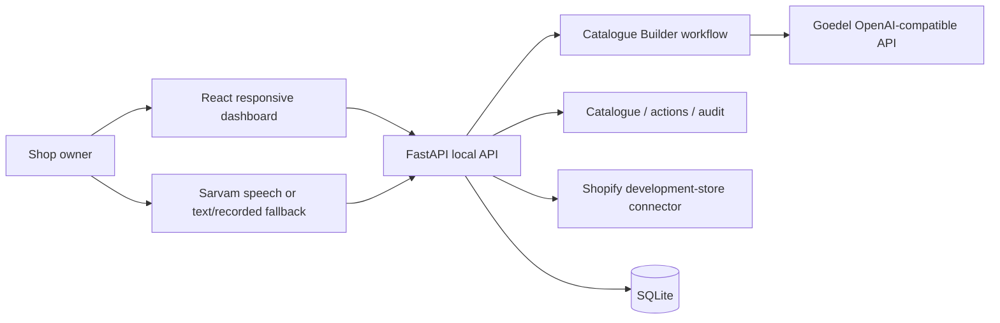

# Architecture overview

## Six-hour architecture

SabBazaar is a local-first modular monolith with a responsive React frontend. It proves one real external integration—Shopify—while keeping Paytm and other marketplaces out of the critical path.



A separate worker is preferred eventually. If Python/FastAPI process setup and SQLite lifecycle cooperate in the six-hour window, move job execution to the worker. If not, an in-process job runner is acceptable only when publication is still:

- initiated by recorded merchant approval,
- protected by server-side policy,
- idempotent,
- persisted and visible in the activity endpoint.

## Runtime boundaries

### Web

- Product/image upload and seeded fixture selection
- Draft editor and warnings
- Approve/reject publication
- Shopify result link/status
- Adjustable price threshold UI
- Activity timeline

### API/application services

- Local merchant/store context
- Product and action persistence
- Calls agent package for draft generation
- Calls policy/approval service before mutation
- Calls connector for approved Shopify operation
- Owns transaction boundaries

### Agent package

- Provider-neutral client configured with `MODEL_BASE_URL=https://api.goedelmachines.com/v1`
- Strict Pydantic structured output
- Evidence/confidence/missing fields
- No connector mutation

### Commerce package

- Canonical product draft/current product
- Merchant approval
- Audit events
- Price threshold policy input
- Publication request guard

### Connector package

- Connector protocol retained for future channels
- Shopify adapter is the only live MVP integration
- Missing access means blocked status, not a fake live result

### Persistence

SQLite is deliberate for a local event demo. Do not introduce PostgreSQL/Redis unless there is time remaining after a stable release candidate and an ADR explains the operational cost.

## Critical sequence

```text
fixture/image + optional voice/text
  -> LLM structured draft (or deterministic fallback)
  -> merchant edits missing fields
  -> approval action recorded
  -> server validates action/policy
  -> Shopify connector creates draft product
  -> audit event records outcome
  -> UI shows product URL/error
```

## Non-negotiable constraints

1. No secret in source or logs.
2. No external call in default automated tests.
3. No Shopify mutation before explicit approval action.
4. No fake “live” success if Shopify is unavailable.
5. Model output missing required facts stays missing until merchant supplies it.
6. Six-hour critical path beats feature breadth and abstraction elegance.
