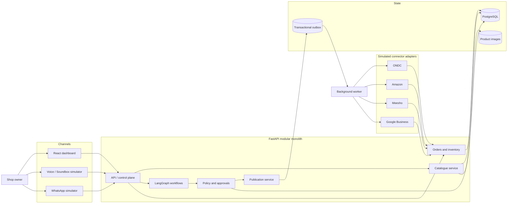

# Architecture overview

## Goal

SabBazaar gives an offline merchant one safe control surface for creating a catalogue, publishing it to multiple marketplaces, handling orders, and synchronizing stock. The hackathon prototype must demonstrate this value without pretending that simulated integrations are production connections.

## Architecture style

Use a modular monolith for business and agent logic, with independently run web, API, and worker processes. PostgreSQL stores canonical state, approvals, audit events, and a transactional job outbox.

This gives the team clear module boundaries without the deployment, networking, and consistency cost of microservices.



## Runtime boundaries

### Merchant application

- Store onboarding and channel status
- Image/bill upload and voice/text requests
- Catalogue review and correction
- Publication and price approvals
- Unified order inbox
- Agent activity and audit timeline

### API/control plane

- Validates requests and establishes merchant context
- Composes domain and agent application services
- Exposes approval and job state
- Does not contain marketplace-specific mapping rules

### Agent workflows

- Convert unstructured merchant input into typed drafts or proposed actions
- Use bounded graphs rather than an unrestricted autonomous loop
- Attach confidence, evidence, missing fields, and a concise rationale
- Never execute a connector command directly

### Commerce core

- Owns the canonical catalogue, listings, orders, inventory ledger, policies, and action lifecycle
- Treats connector data as incoming observations to normalize and validate
- Emits durable jobs and domain events in the same transaction as state changes

### Worker/connectors

- Claims queued work safely
- Executes idempotent channel operations
- Normalizes results and inbound events
- Retries transient failures and exposes terminal failures for merchant resolution

## Core command flow

```text
Merchant request or domain event
  -> agent/domain service creates ProposedAction
  -> policy evaluates risk and missing data
  -> automatic approval OR merchant approval task
  -> approved command enters transactional outbox
  -> worker calls channel adapter with idempotency key
  -> adapter result updates Listing/Order state
  -> AuditEvent records each transition
```

## Architectural principles

1. One canonical product can have many channel listings.
2. Inventory is a ledger, not an editable number copied independently to each platform.
3. External operations are at-least-once, so consumers and connectors must be idempotent.
4. AI output is untrusted input until schema and policy validation pass.
5. Human approval is a first-class state, not a UI-only confirmation dialog.
6. Every demo dependency has a deterministic local fallback.
7. Marketplace simulation is visible in the UI and documentation.

## Deferred production concerns

- Marketplace certification and production credentials
- Paytm production data and physical Soundbox integration
- Enterprise authentication, tenant isolation, and regional data controls
- High-volume event streaming and independent service scaling
- Real settlement movement, lending, refunds, and delivery orchestration
